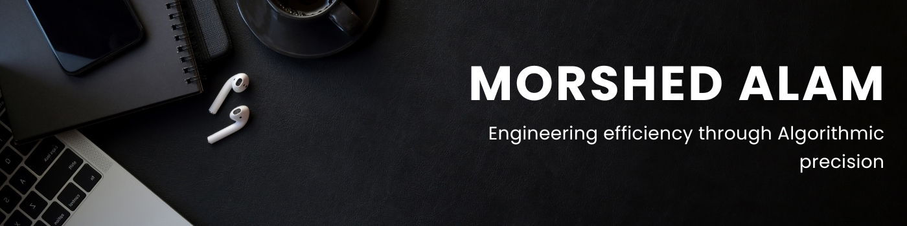

#  Hi there

I'm a **Software Engineer based in Wuhan, China**, with experience building web applications, backend services, and systems that connect physical devices to software.

My work spans **frontend development, backend architecture, database design, IoT integration, and cloud operations**. I enjoy understanding how the pieces fit together—from the interface someone uses to the API, device connection, and deployment workflow behind it.

I'm also developing my **Data Engineering** skills through Python, SQL, data modeling, and practical pipeline projects.

[Portfolio](https://www.morshedalam.dev/) · [LinkedIn](https://www.linkedin.com/in/morshedalamdev/) · [Email](mailto:morshedalam.dev@outlook.com)

## Technical Arsenal

- **Languages:** TypeScript, JavaScript, Go, Python, SQL
- **Frontend:** React, Next.js, Vite, Tailwind CSS, React Native
- **Backend and APIs:** Node.js, NestJS, Express.js, FastAPI, REST APIs, WebSockets, Socket.IO
- **Databases and processing:** PostgreSQL, MongoDB, Firebase, Redis, TypeORM, SQLAlchemy, BullMQ
- **IoT integration:** TCP communication, binary protocol handling, device data ingestion, telemetry and alarm processing
- **Cloud and delivery:** Alibaba Cloud ECS, Linux, Docker, Nginx, PM2, GitHub Actions, Cloudflare Pages, CI/CD

## Professional Work

At **Yuedong Xinghe Science and Technology Innovation Co., Ltd.**, I progressed from **Backend Engineer to Software Engineer** while working on an industrial management platform with IoT integration.

My contributions included:

- **Architecture and full-stack development:** Contributed to platform architecture and built functionality across a modular NestJS backend, PostgreSQL data models, and React operational interfaces.
- **IoT device integration:** Built custom TCP servers and binary protocol adapters to receive device data, normalize telemetry and alarms, and make that information available through backend APIs.
- **Reliable data processing:** Implemented validation, idempotent processing, retries, controlled replay, and data import workflows with traceability.
- **Authentication and access control:** Developed authentication, role-based permissions, scoped data access, and audit capabilities.
- **Cloud infrastructure and delivery:** Managed Alibaba Cloud ECS servers and deployment workflows involving Nginx/TLS, PM2 releases, database migrations, health checks, rollback procedures, and CI pipelines.

_This was employer-owned work; the source code is private._

At **Hubei Wanlu Zhixin Technology**, I worked on a **smart-home integration prototype** connecting a React dashboard, NestJS API, live camera feed, and Python vision worker.

My earlier experience includes web development for **Express Kitchens & Bath** and freelance work covering requirements, implementation, API integration, revisions, and client handover.

## Current Focus

- 🌱 Deepening my **Data Engineering** skills through Python, SQL, ETL/ELT practice, data cleaning, and data modeling.
- 🧱 Learning more about **data warehousing and Snowflake** through hands-on study.
- ⚙️ Improving backend design, processing reliability, and deployment workflows.
- 🧠 Practicing data structures and algorithms on [LeetCode](https://leetcode.com/u/morshedalamdev) and [HackerRank](https://www.hackerrank.com/profile/morshedalamdev).

I use **Codex and Claude Code** to support planning, implementation, refactoring, testing, and documentation. I take responsibility for reviewing the work, validating behavior, and making the final engineering decisions.

Outside engineering, I enjoy **hiking and photography**.

## Let's Connect

I'm open to **Software Engineer**, **Backend Engineer**, and **Full-Stack Engineer** opportunities. I'm also interested in **entry-level Data Engineer** roles where I can develop my pipeline and data modeling skills further.

- **Portfolio:** [morshedalam.dev](https://www.morshedalam.dev/)
- **LinkedIn:** [morshedalamdev](https://www.linkedin.com/in/morshedalamdev/)
- **Email:** [morshedalam.dev@outlook.com](mailto:morshedalam.dev@outlook.com)
- **Freelance:** [Tech Infiny on Fiverr](https://www.fiverr.com/tech_infiny)

[Facebook](https://facebook.com/itsmorshedalam) · [Instagram](https://instagram.com/its_morshedalam) · [X](https://twitter.com/morshedalamdev)
